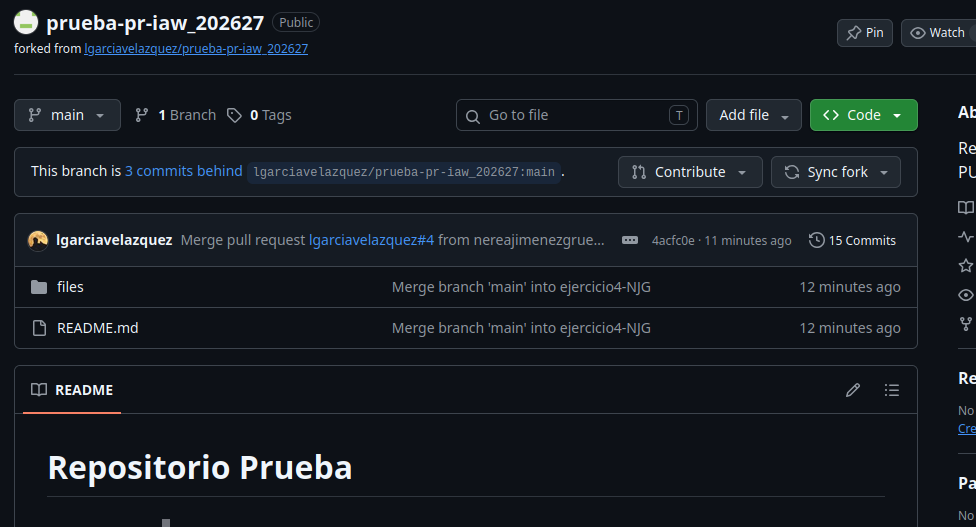
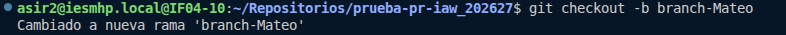
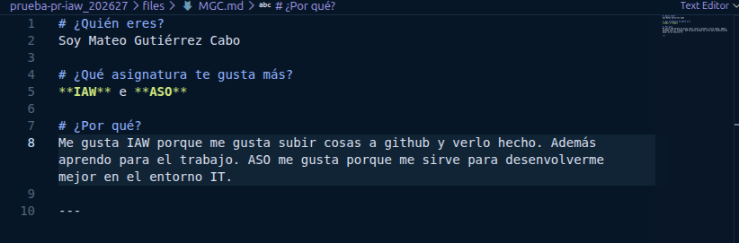
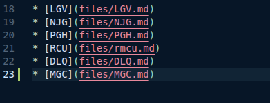
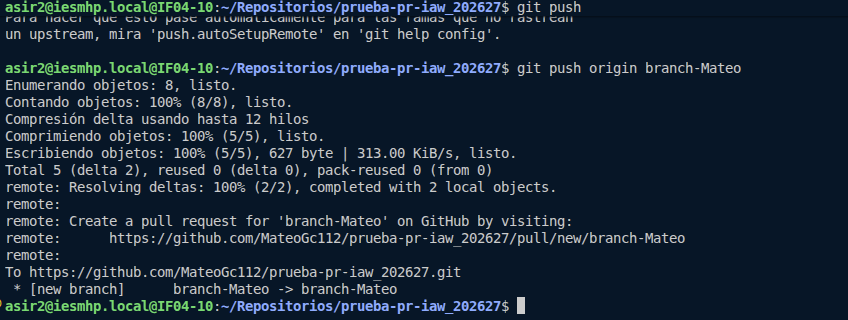
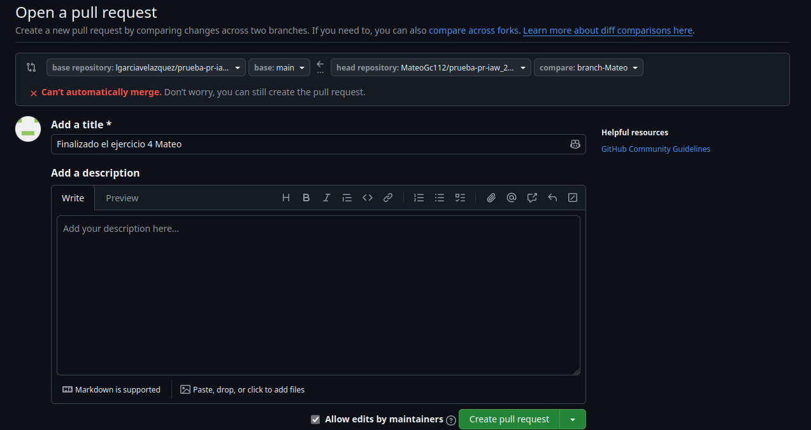
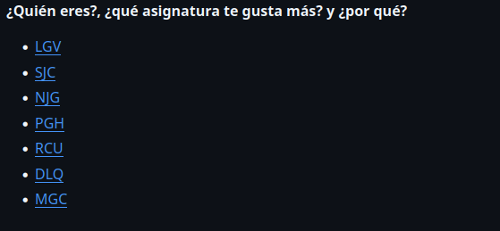

## Principio del ejercicio4
### Mateo Gutiérrez

Copia del repositorio:  
 

Creación de mi rama:  
 

Creación de mi file:  
 

creación del link en README:  

Ahora toca hacer el push y el request:  

Hacemos el pull request en github:  
  

Todo actualizado:  
 